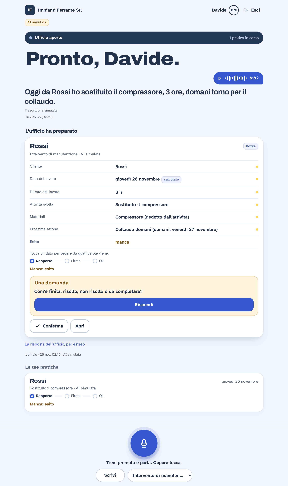

# Vincenzo Siciliano

Italiano · [English](README.en.md)

**Sviluppatore Java backend e full stack con React e TypeScript**, in Calabria. Cerco collaborazioni freelance da remoto, in partita IVA.

Da oltre due anni in Accenture sviluppo integrazioni a eventi in Java per un programma assicurativo internazionale. Fuori dal lavoro costruisco prodotti miei, dal database all’interfaccia.

## Esperienza professionale

**Accenture, dal 2024.** Team di integrazione di un programma multi-paese per un primario gruppo assicurativo internazionale: 6 paesi, oltre 200 persone di più società.

- Sviluppo in Java 17 un sistema a eventi su Spring Boot: route e processor Apache Camel su Kafka che trasformano eventi di polizza, sinistri e contabilità in email, SMS e lettere, per 3 paesi in parallelo.
- Ho scritto oltre 150 script SQL su PostgreSQL: nuove tabelle, viste e modifiche allo schema, rilasciati con Liquibase e pipeline Azure DevOps.
- Ho lavorato su oltre 60 ticket e completato oltre 100 pull request, dall’analisi al rilascio. Scrivo test con JUnit 5 e Mockito e configuro il deploy con Helm su Kubernetes.
- Ho integrato API REST e SOAP interne ed esterne e ho lavorato anche con Docker.

## Stack

- **Backend:** Java 17 e 25 · Spring Boot · Apache Camel · Kafka · REST · SOAP
- **Dati:** PostgreSQL · SQL · JDBC · Liquibase
- **Web:** TypeScript · React · Next.js · Node.js
- **Rilascio e test:** Docker · Kubernetes · Helm · Azure DevOps · GitHub Actions · JUnit 5 · Mockito · Vitest · Playwright
- **Mobile e giochi:** Swift · SwiftUI · Unity · C#
- **AI per lo sviluppo:** Claude Code · GitHub Copilot · Codex. Verifico e testo ogni modifica.

## Prodotti e progetti

- **[Agenda Ambulatorio](https://github.com/Il-Sic/agenda-ambulatorio)** è un progetto dimostrativo full stack per prenotare le visite di un poliambulatorio, con Java 25, Spring Boot, PostgreSQL, Kafka, React e TypeScript. Lo stesso orario non può essere prenotato due volte: lo garantisce un vincolo del database e lo dimostra un test di concorrenza. Il codice è pubblico e si avvia con un comando.

  

- **[Rapporto Pronto](case-studies/rapporto-pronto.md)** è un SaaS B2B in sviluppo, non ancora in produzione. Trasforma le note vocali dei tecnici sul campo in rapportini che l’ufficio può verificare. L’ho progettato e sviluppato da solo in TypeScript, con Next.js, React e Node.js. I dati stanno in PostgreSQL, con ogni azienda isolata nel database (Row Level Security). Deepgram trascrive i vocali e un modello OpenAI scrive la bozza. Il codice è privato: lo mostro volentieri in call.

  

- **[Argonauta](case-studies/argonauta.md)** è la mia app iOS in Swift e SwiftUI per esplorare il territorio a piedi. Chi cammina può seguire una rotta, raccogliere schede su ciò che incontra e ritrovare le proprie scoperte nel Diario. L’app è attualmente in fase di test su iPhone e iPad.
- **Cirullone** è un videogioco di carte che sto sviluppando in Unity e C#, ispirato alla tradizione italiana dei giochi di carte.
- **[sicstudio.app](https://sicstudio.app/)** è il mio sito, in italiano e in inglese: HTML e CSS senza framework né JavaScript. Gli script Python generano le parti ripetute delle pagine e GitHub Actions controlla e pubblica il sito.

Sic Studio è il marchio personale con cui sviluppo app e videogiochi.

## Contatti

[vincenzo@sicstudio.app](mailto:vincenzo@sicstudio.app) · [LinkedIn](https://www.linkedin.com/in/vincenzo-siciliano-dev/) · [sicstudio.app](https://sicstudio.app/)
