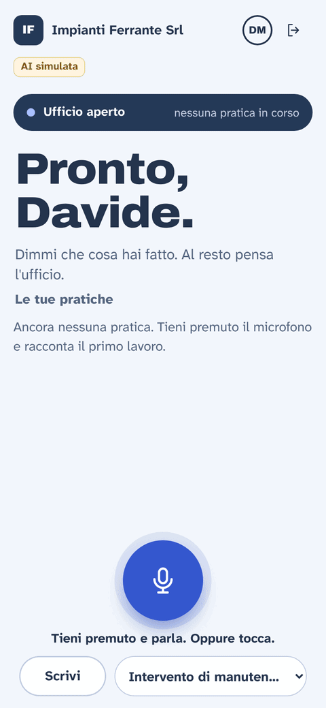
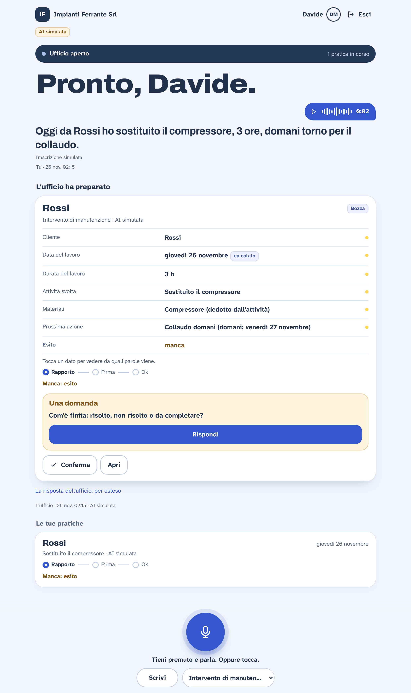
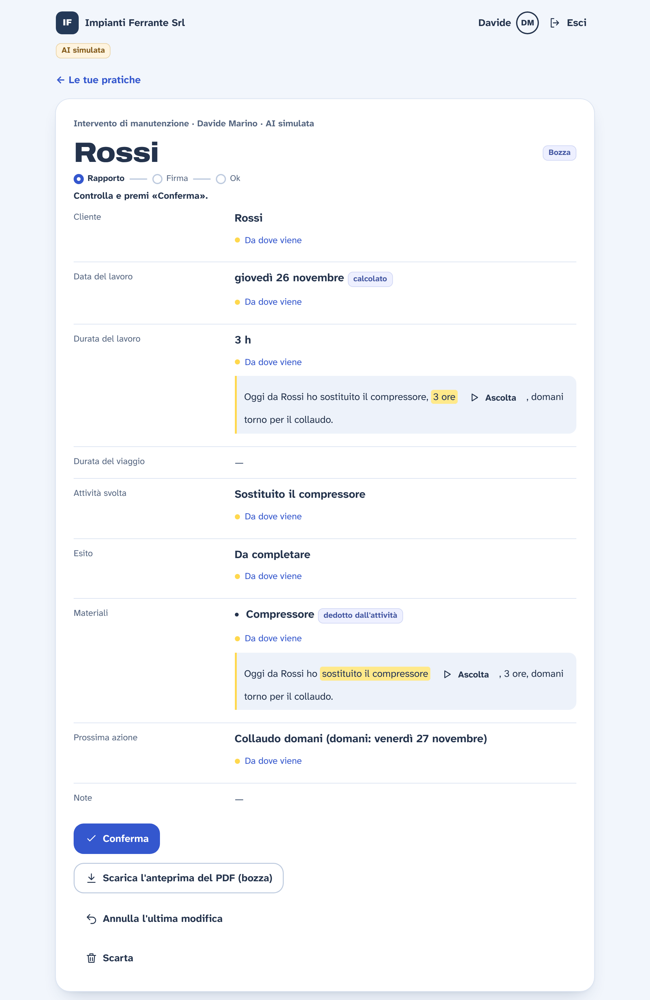
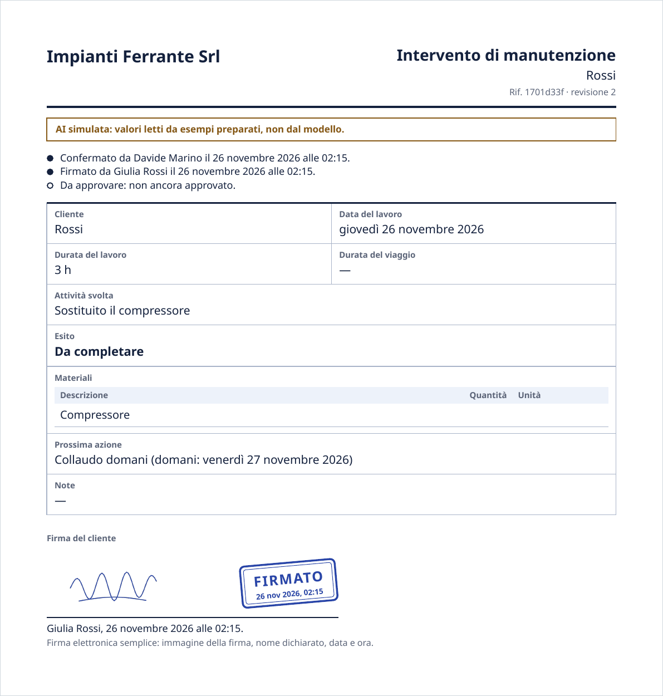

# Rapporto Pronto

[Italiano](rapporto-pronto.md) · English · [Profile](../README.en.md)

I’m building Rapporto Pronto for field technicians who document maintenance visits. After a visit, the technician knows what happened on site. The office needs that account in writing. The app lets the technician dictate a note and check the resulting service report.

## From a note to a reviewed report

A technician can dictate or type a note. For a recording, they can read the transcript during review and replay the passage behind a detail in the report. If a part name looks wrong, they can check what they said, correct the draft and confirm the report.

I built the review interface with React, TypeScript and Next.js. The Node.js backend processes notes in the background and stores reports in PostgreSQL. I kept the original note available during review because a plausible sentence can still describe the wrong repair.

## AI integrations and simulated mode

The first prototype simulated text interpretation. In the current version, I’ve integrated Deepgram to transcribe audio and OpenAI to interpret the text and populate the draft report. For development and testing, I can also simulate both steps using sample transcripts and responses without calling either service.

## Technical choices

- **Data separated by company.** Each company’s data is isolated in PostgreSQL with Row Level Security. I access the database with Drizzle.
- **Invite-only access.** People join with a single-use invite, handled by Better Auth.
- **Long jobs in a queue.** Transcription and drafting go through a pg-boss queue, with a worker separate from the web application.
- **PDF.** PDF reports are generated with pdfkit.
- **Tests and checks.** I write tests with Vitest and Playwright and run them on GitHub Actions. Simulated mode lets them run without calling the external services.
- **Deployment.** The Docker environment is already prepared, with encrypted backups and error monitoring, but it is not live yet.

## Project status

Note capture, drafting, review and the customer’s signature are implemented in the development build. Rapporto Pronto is not yet in production.

The code is private because the product is still in development. I’m happy to walk through it on a call.
