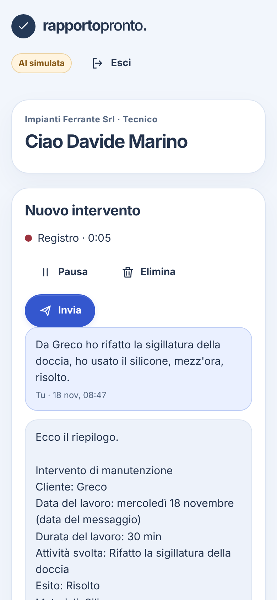
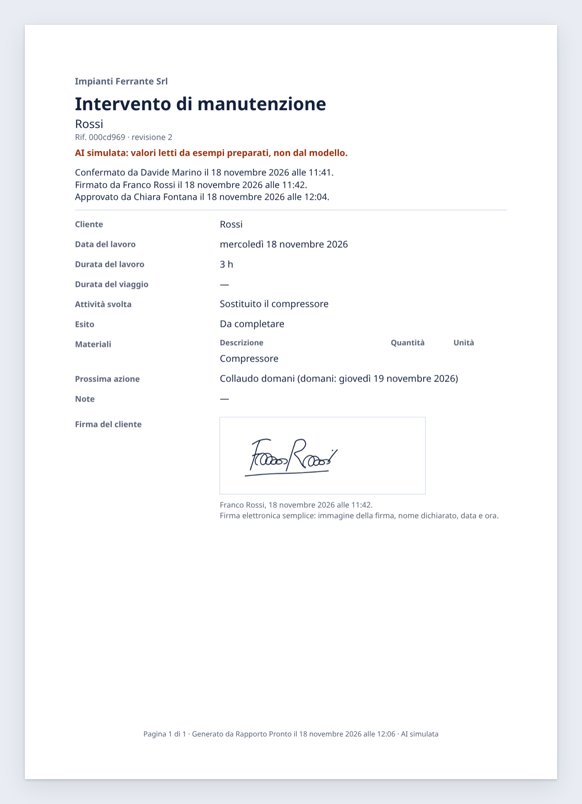

# Rapporto Pronto

Italiano · [English](rapporto-pronto.en.md) · [Profilo](../README.md)

Sto sviluppando Rapporto Pronto per i tecnici che devono documentare gli interventi di manutenzione. A fine intervento il tecnico sa che cosa ha fatto, mentre all’ufficio serve un resoconto scritto. Con l’app può dettare la propria nota e verificare il rapportino che ne viene ricavato.

## Dalla nota al rapportino

Il tecnico può dettare o scrivere una nota. Se parte da una registrazione, durante la revisione può leggere la trascrizione e riascoltare il passaggio a cui si riferisce un dato. Se il nome di un ricambio sembra sbagliato, può tornare alle proprie parole, correggere la bozza e confermare il rapportino.

Ho sviluppato l’interfaccia di revisione in React e TypeScript con Next.js. Il backend Node.js elabora le note in background e salva i rapportini in PostgreSQL. Ho mantenuto la nota originale a portata di mano durante la revisione perché anche una frase plausibile può descrivere un intervento diverso da quello eseguito.

## Integrazioni AI e modalità simulata

Nel primo prototipo l’interpretazione del testo era simulata. Nella versione attuale ho integrato Deepgram per trascrivere l’audio e OpenAI per interpretare il testo e compilare la bozza. Per lo sviluppo e i test posso anche simulare entrambe le fasi con trascrizioni e risposte di prova, senza chiamare i due servizi.

## Scelte tecniche

- **Dati separati per azienda.** I dati di ogni azienda sono isolati in PostgreSQL con Row Level Security. Accedo al database con Drizzle.
- **Accessi su invito.** Si entra con un invito monouso, gestito con Better Auth.
- **Lavori lunghi in coda.** La trascrizione e la scrittura della bozza passano da una coda pg-boss, con un worker separato dall’applicazione web.
- **PDF.** I rapportini in PDF sono generati con pdfkit.

- **Test e controlli.** Scrivo i test con Vitest e Playwright e li faccio girare su GitHub Actions. La modalità simulata permette di provarli senza chiamare i servizi esterni.
- **Rilascio.** L’ambiente Docker è già preparato, con backup cifrati e monitoraggio degli errori, ma non è ancora attivo.

## Stato del progetto

L’acquisizione della nota, la creazione della bozza e la revisione sono implementate nella versione di sviluppo. Rapporto Pronto non è ancora in produzione.

Il codice è privato perché è un prodotto in sviluppo. Lo mostro volentieri in call.
